# Android PIN at enrollment: evidence

Every test below shows its result, the pictures and links to the raw output. Generated by `testing/_framework/bin/build-evidence-index.py`; do not edit by hand.

## Summary

| Result | Tests |
|---|---|
| PASS | 4 |
| PARTIAL | 3 |

| Group | Test | Result | Section |
|---|---|---|---|
| Setup | S-1: fleets and profiles applied | PASS | [open](#s-1-fleets-and-profiles-applied) |
| Setup | S-2: android mdm and labels exception | PASS | [open](#s-2-android-mdm-and-labels-exception) |
| Setup | S-3: setup check | PASS | [open](#s-3-setup-check) |
| Option 2: PIN profile in the enrollment fleet | O2-1: option 2 normal pace | PASS | [open](#o2-1-option-2-normal-pace) |
| Option 2: PIN profile in the enrollment fleet | O2-2: option 2 normal pace | PARTIAL | [open](#o2-2-option-2-normal-pace) |
| Option 2: PIN profile in the enrollment fleet | O2-3: option 2 fast pace | PARTIAL | [open](#o2-3-option-2-fast-pace) |
| Option 2: PIN profile in the enrollment fleet | O2-4: option 2 fast pace | PARTIAL | [open](#o2-4-option-2-fast-pace) |

## Setup

### S-1: fleets and profiles applied

**Result: PASS** · [full notes](test-evidence/S/S-1-fleets-and-profiles-applied/result.md)

- **Objective:** GitOps created the four fleets with the right profiles
- **Expected:** three fleets with pin-block-0, staging with none, the label fleet scoped to android-pin-ready

**Output:** [01-version.txt](test-evidence/S/S-1-fleets-and-profiles-applied/01-version.txt) · [02-fleets.txt](test-evidence/S/S-1-fleets-and-profiles-applied/02-fleets.txt) · [03-profiles.txt](test-evidence/S/S-1-fleets-and-profiles-applied/03-profiles.txt) · [04-labels.txt](test-evidence/S/S-1-fleets-and-profiles-applied/04-labels.txt)

---

### S-2: android mdm and labels exception

**Result: PASS** · [full notes](test-evidence/S/S-2-android-mdm-and-labels-exception/result.md)

- **Objective:** Android MDM is on and GitOps can manage labels
- **Expected:** android_enabled_and_configured true, labels exception false

**Output:** [01-config.txt](test-evidence/S/S-2-android-mdm-and-labels-exception/01-config.txt)

---

### S-3: setup check

**Result: PASS** · [full notes](test-evidence/S/S-3-setup-check/result.md)

- **Objective:** API access from private/fleet.env works
- **Expected:** version shown

**Output:** [01-api.txt](test-evidence/S/S-3-setup-check/01-api.txt)

---

## Option 2: PIN profile in the enrollment fleet

### O2-1: option 2 normal pace

**Result: PASS** · [full notes](test-evidence/O2/O2-1-option-2-normal-pace/result.md)

- **Objective:** PIN prompt in setup
- **Expected:** PIN prompt, no block

**Output:** [01-watch.txt](test-evidence/O2/O2-1-option-2-normal-pace/01-watch.txt) · [02-watch.txt](test-evidence/O2/O2-1-option-2-normal-pace/02-watch.txt) · [03-host.txt](test-evidence/O2/O2-1-option-2-normal-pace/03-host.txt) · [04-activity.txt](test-evidence/O2/O2-1-option-2-normal-pace/04-activity.txt) · [05-server-logs.txt](test-evidence/O2/O2-1-option-2-normal-pace/05-server-logs.txt)

**qr scanner**

**service provider restart**

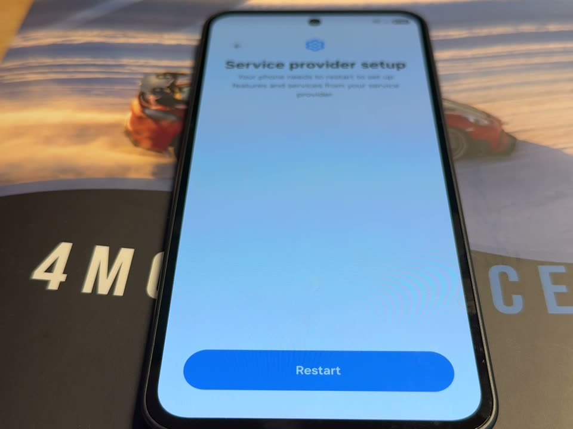

**registering device**

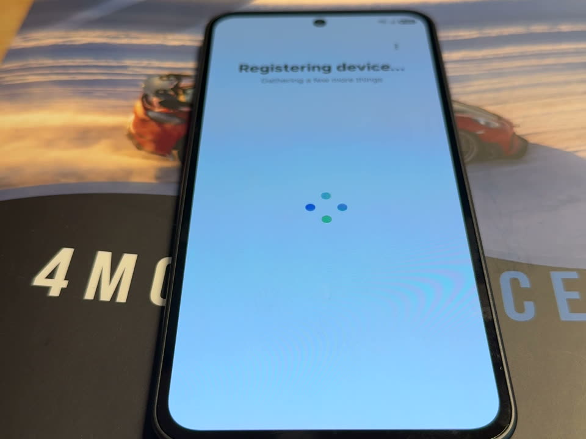

**set a new screen lock**

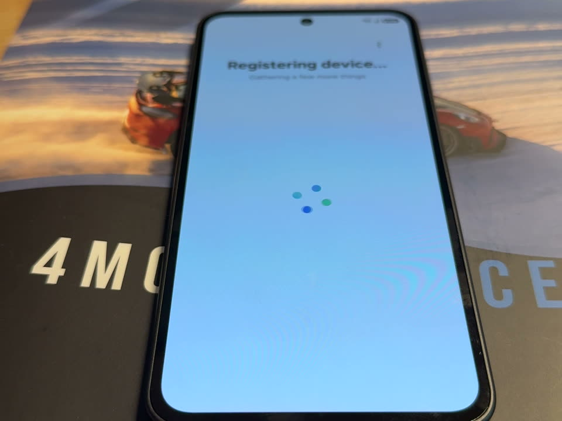

**home screen**

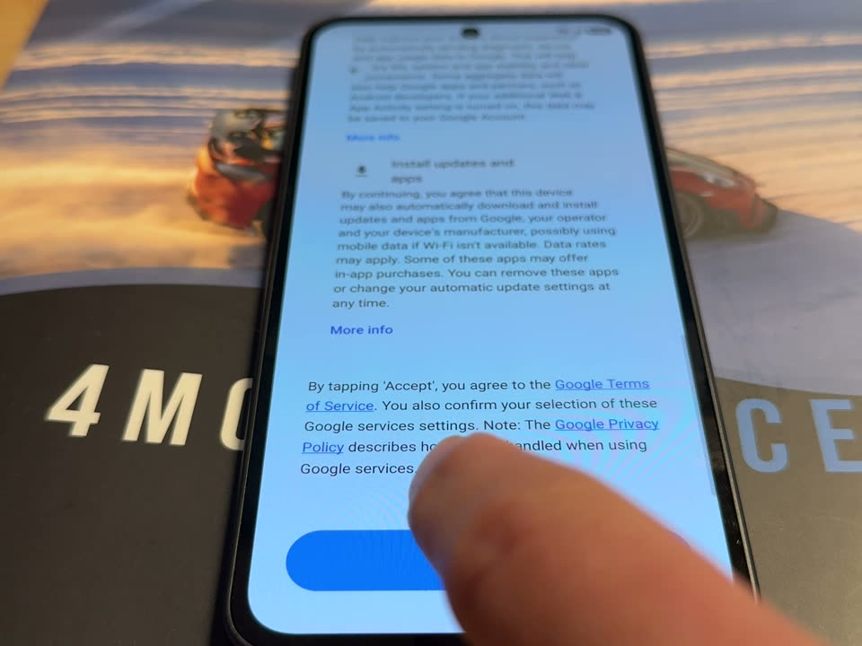

---

### O2-2: option 2 normal pace

**Result: PARTIAL** · [full notes](test-evidence/O2/O2-2-option-2-normal-pace/result.md)

- **Objective:** PIN prompt in setup
- **Expected:** PIN prompt, no block

**Output:** [01-watch.txt](test-evidence/O2/O2-2-option-2-normal-pace/01-watch.txt) · [02-host.txt](test-evidence/O2/O2-2-option-2-normal-pace/02-host.txt) · [03-activity.txt](test-evidence/O2/O2-2-option-2-normal-pace/03-activity.txt) · [04-server-logs.txt](test-evidence/O2/O2-2-option-2-normal-pace/04-server-logs.txt)

**set up your phone**

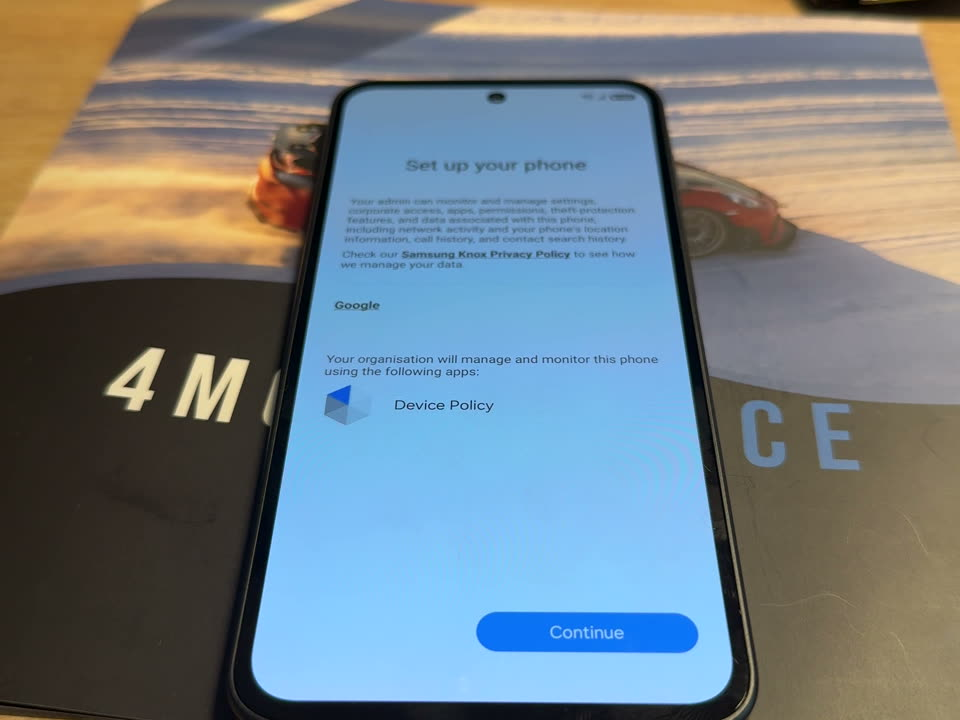

**registering device**

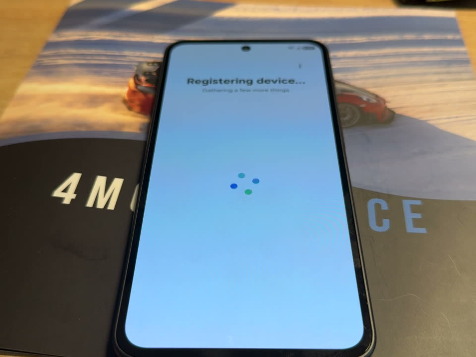

**google services policy arrives**

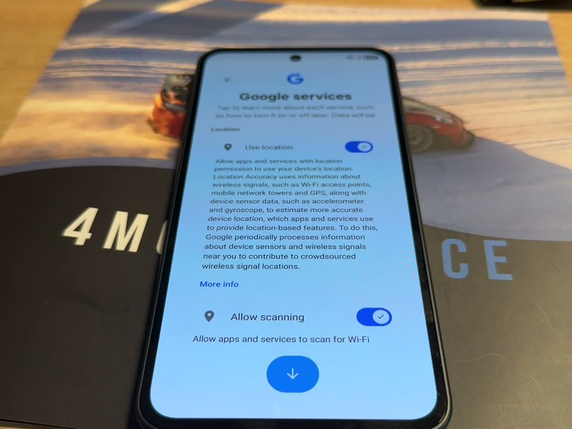

**home apps greyed**

**action not allowed**

**unblock your apps notification**

**set a new screen lock**

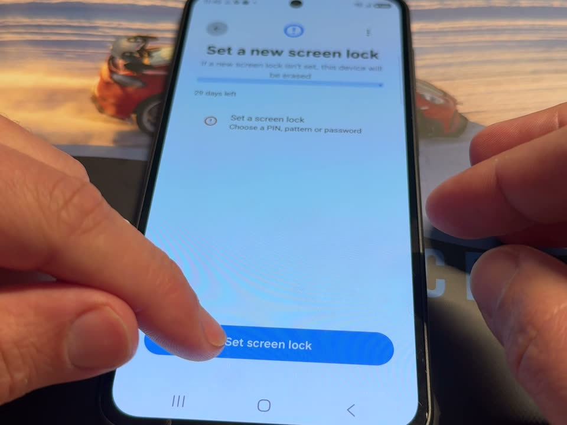

**home unblocked**

---

### O2-3: option 2 fast pace

**Result: PARTIAL** · [full notes](test-evidence/O2/O2-3-option-2-fast-pace/result.md)

- **Objective:** Can a fast pace block setup? Does the unblock message show?
- **Expected:** PASS or PARTIAL; FAIL if stuck in setup

**Output:** [01-watch.txt](test-evidence/O2/O2-3-option-2-fast-pace/01-watch.txt) · [02-host.txt](test-evidence/O2/O2-3-option-2-fast-pace/02-host.txt) · [03-activity.txt](test-evidence/O2/O2-3-option-2-fast-pace/03-activity.txt) · [04-server-logs.txt](test-evidence/O2/O2-3-option-2-fast-pace/04-server-logs.txt)

**cant set up device attempt 1**

**registering device**

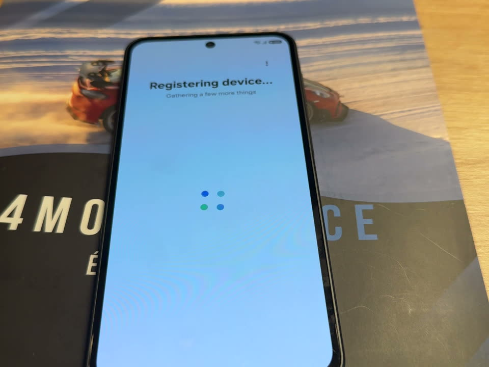

**google services policy arrives**

**action not allowed custom message**

**set a new screen lock**

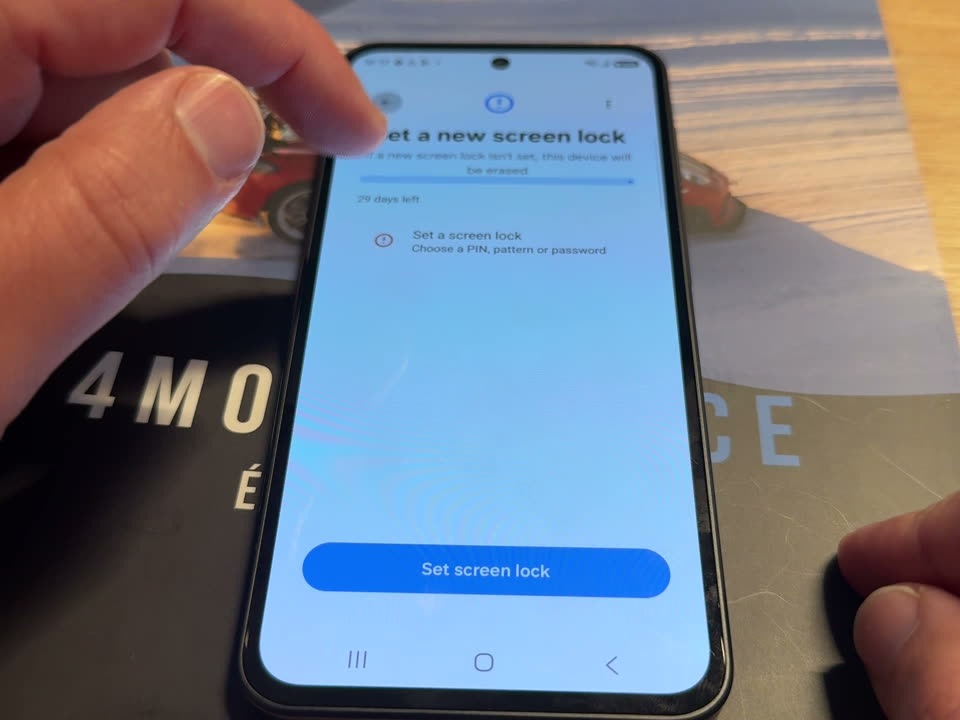

**home unblocked**

---

### O2-4: option 2 fast pace

**Result: PARTIAL** · [full notes](test-evidence/O2/O2-4-option-2-fast-pace/result.md)

- **Objective:** Can a fast pace block setup? Does the new unblock message read well?
- **Expected:** PASS or PARTIAL; FAIL if stuck in setup

**Output:** [01-watch.txt](test-evidence/O2/O2-4-option-2-fast-pace/01-watch.txt) · [02-host.txt](test-evidence/O2/O2-4-option-2-fast-pace/02-host.txt) · [03-activity.txt](test-evidence/O2/O2-4-option-2-fast-pace/03-activity.txt) · [04-server-logs.txt](test-evidence/O2/O2-4-option-2-fast-pace/04-server-logs.txt)

**home apps greyed**

**samsung notifications tip**

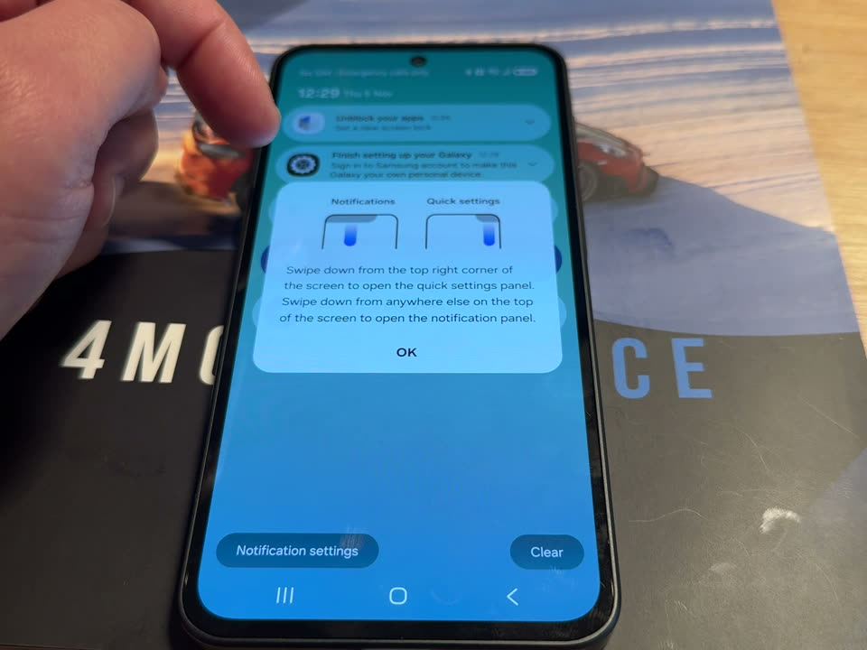

**action not allowed new message**

**set a new screen lock erase warning**

**home unblocked**

---
