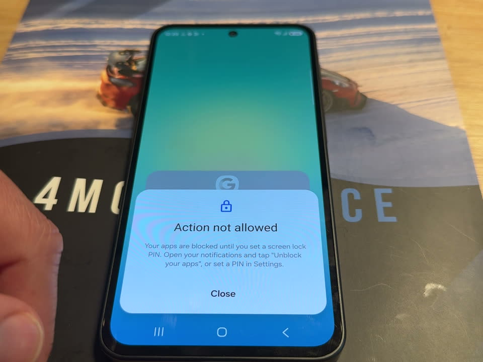

<!-- Draft for fleetdm/fleet#57607. Not posted. Adam reviews and posts. -->

**Update: workaround #2 enforced the PIN in every run. Adding a custom message tells end users how to unblock.**

> [!NOTE]
> Tested with **QR enrollment** on Fleet 4.94.0 with one Samsung Galaxy A27 5G (SM-A276B, Android 16, patch
> 2026-05-05), 4 runs on 2026-11-05. The customer enrolls with **zero-touch**, which we couldn't test yet: the lab has
> no zero-touch customer account. Both methods enroll with the same default policy, so we expect the same behavior.

### Results

| Run | Pace | PIN prompt in setup | Blocked in setup | After setup | Result |
|---|---|---|---|---|---|
| 1 | Normal | Yes, "Set a new screen lock" | No | Home screen with a PIN set | PASS |
| 2 | Normal | No | No | Apps blocked until a PIN was set | PARTIAL |
| 3 | Fast | No | No | Apps blocked; custom message shown | PARTIAL |
| 4 | Fast | No | No | Apps blocked; custom message shown | PARTIAL |

The PIN was enforced in all 4 runs. Either Android asked for it during setup, or the apps were blocked at the home
screen until the end user set one. We didn't see the reported "blocked by your work policy" during setup.

Full evidence, with photos of each screen, Fleet timelines and server logs:
**[EVIDENCE.md](https://github.com/AdamBaali/fleet.mpc.ad-gitops/blob/main/testing/android-pin-57607/EVIDENCE.md)**
(per-run timings: [RESULTS.md](https://github.com/AdamBaali/fleet.mpc.ad-gitops/blob/main/testing/android-pin-57607/RESULTS.md))

### Why it differs between runs

The enrollment token for QR and zero-touch points at Fleet's default policy, which has no password settings
([service.go](https://github.com/fleetdm/fleet/blob/fleet-v4.94.0/server/mdm/android/service/service.go#L689-L698),
[ee service.go](https://github.com/fleetdm/fleet/blob/fleet-v4.94.0/ee/server/mdm/android/service.go#L128-L134)).
A job that runs every 30 seconds then sends the fleet's profiles to the host
([profiles.go](https://github.com/fleetdm/fleet/blob/fleet-v4.94.0/server/mdm/android/service/profiles.go#L436-L486)).

- In run 1 the policy reached the device 12 seconds after enrollment, while it was still on "Registering device...".
  Android Device Policy then asked for the screen lock as part of setup.
- In runs 2 to 4 it arrived 19 to 21 seconds after enrollment, after that step. Setup finished without a prompt, and
  `blockAfterDays: 0` blocked the apps at the home screen.

Where enrollment lands in the 30-second cycle decides which one happens. The end user can't influence it.

### What we used

Two Android configuration profiles in the enrollment fleet.

**1. Password profile** ([pin-block-0.json](https://github.com/AdamBaali/fleet.mpc.ad-gitops/blob/main/lib/android/configuration-profiles/pin-block-0.json)):
device PIN, at least 6 digits, no repeating or ordered sequences, block at once, wipe after 30 days with factory reset
protection kept.

```json
{
  "passwordPolicies": [
    {
      "passwordScope": "SCOPE_DEVICE",
      "passwordQuality": "NUMERIC_COMPLEX",
      "passwordMinimumLength": 6
    }
  ],
  "policyEnforcementRules": [
    {
      "settingName": "passwordPolicies",
      "blockAction": { "blockAfterDays": 0 },
      "wipeAction": { "wipeAfterDays": 30, "preserveFrp": true }
    }
  ]
}
```

**2. Custom message profile** ([pin-unblock-message.json](https://github.com/AdamBaali/fleet.mpc.ad-gitops/blob/main/lib/android/configuration-profiles/pin-unblock-message.json)):

```json
{
  "shortSupportMessage": {
    "defaultMessage": "Your apps are blocked until you set a screen lock PIN. Open your notifications and tap \"Unblock your apps\", or set a PIN in Settings."
  }
}
```

### How the custom message works

Without it, tapping a blocked app only says "Action not allowed. You do not have permission to perform this action.
Contact your organisation's IT administrator for more information." Nothing tells the end user to set a PIN, so they
call IT.

`shortSupportMessage` is an Android Management API policy field: "A message displayed to the user in the settings
screen wherever functionality has been disabled by the admin"
([Policy reference](https://developers.google.com/android/management/reference/rest/v1/enterprises.policies)).
In our runs it replaced the text of the blocked-app dialog. The Samsung kept its own title, "Action not allowed", with
our text below it. The end user followed it, opened the "Unblock your apps" notification, and set a PIN in about a
minute.



To add it:

1. Save the JSON above as a `.json` file. Use it as its own profile, or add `shortSupportMessage` to the password
   profile. Fleet merges profiles by top-level key, so the two don't conflict.
2. In Fleet, go to **Controls > OS settings > Configuration profiles**, pick the fleet the devices enroll into, and
   select **Add profile**. With GitOps, list it under `controls.android_settings.configuration_profiles` in the fleet's
   YAML, next to the password profile
   ([our fleet file](https://github.com/AdamBaali/fleet.mpc.ad-gitops/blob/main/fleets/android-pin-test-block0.yml)).
3. Keep the text under 200 characters (Google may truncate longer text). For other languages, add
   `localizedMessages`, for example `"localizedMessages": { "fr-FR": "..." }`.

We tested it on one Samsung. Other makes may lay out the dialog differently, which is why the text names the
notification and Settings rather than a Samsung menu path.

### Recommendation

Keep workaround #2 with both profiles, and add one line to the end user instructions: "If setup doesn't ask for a PIN,
your apps will be greyed out. Open your notifications, tap **Unblock your apps**, and set a PIN."

### Other things to know

- **End users see an erase warning.** The "Set a new screen lock" screen says "If a new screen lock isn't set, this
  device will be erased" with "29 days left". That comes from the `wipeAction`. Google requires a `wipeAction` with
  every `blockAction`. With no enforcement rule at all, Google blocks at once and wipes after 10 days without keeping
  factory reset protection, so check the customer's current profile for this.
- **The JSON in this issue's screenshot wouldn't apply.** `ComplianceRule` has no `blockAction`, `PASSWORD_NOT_SET`
  isn't a value in the API, and `passwordRequirements` is deprecated. The working form of the BlockAction fallback is
  `policyEnforcementRules`, as above.
- **Keep `passwordPolicies` and `policyEnforcementRules` in one profile.** A second profile with
  `policyEnforcementRules` would replace the first one's rules.

### What we still need

- The customer's device models, Android versions and current profile. The setup block they reported may depend on the
  device, and we tested one Samsung.
- A photo of "blocked by your work policy" from their side, to see which setup screen it lands on.
- Zero-touch confirmation once the lab has a zero-touch customer account.

### Possible product change

Put the fleet's profiles in the policy the enrollment token names, so the password requirement is on the device from
the first moment of management instead of arriving 12 to 21 seconds later. We expect Android would then ask for the
PIN in setup every time, as in run 1. Untested: needs a Fleet change.
