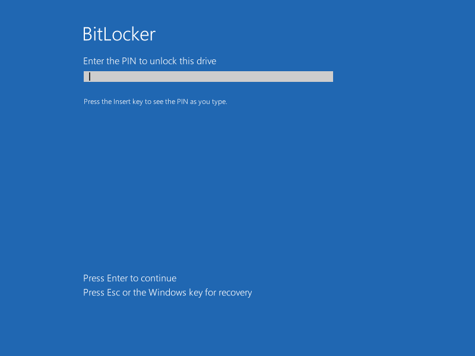
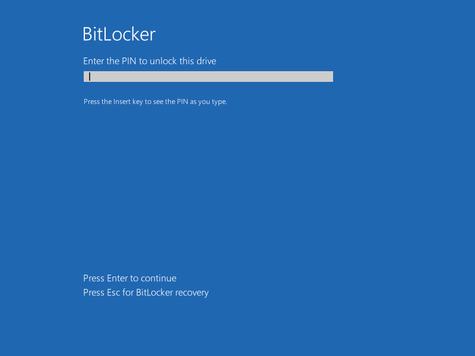
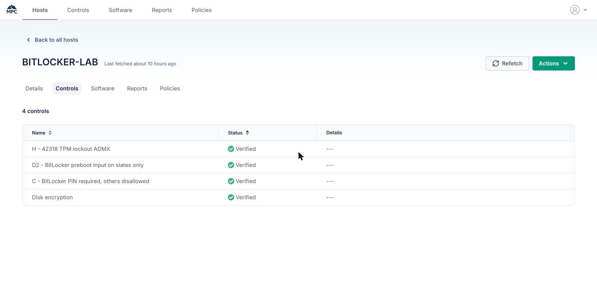

# Evidence: BitLocker PIN on Windows (fleetdm/fleet#42318)

Lab, 2026-10-15/16: Fleet 4.93.0 (`https://fleet.mpc.ad`, server option `FLEET_MDM_ENABLE_CUSTOM_DISK_ENCRYPTION=true`), fleet 7
"Windows BitLocker Lab", Windows 11 Pro 26H2 (build 26300) arm64 VM in UTM 4.7.5 with TPM 2.0, fleetd 1.61.0. The customer
setup: **no Fleet Desktop**, signed in as a **standard user** (`labuser`). Chronological log with every step and dead end:
[LOG.md](LOG.md). Screenshots never show a PIN (dots only) or a recovery key (only its ID).

## Summary
| # | Question | Answer | Tests |
|---|---|---|---|
| 1 | Does Fleet's "Require BitLocker PIN" payload work? | Yes on a desktop-class device: an admin gets "Enter a PIN" and can add one to an encrypted drive. Bug not reproduced there. | B-1..B-4 |
| 2 | Can a standard user set the PIN without Fleet Desktop? | **No.** No prompt; Manage BitLocker asks for admin credentials, with Fleet's setting and with PIN *Required*. | C-1, C-2a, N-2 |
| 3 | Can IT set the PIN from Fleet? | **Yes.** A Fleet script adds TPM+PIN on the encrypted drive; Fleet shows Verified; a policy reports hosts without a PIN. | C-2b, C-3, N-2b, PO-1 |
| 4 | Can the standard user then change it? | Yes, no admin prompt (old + new PIN). After 4–5 wrong old PINs Windows blocks changes until an admin resets it. | D-1, L-2 |
| 5 | Why do some devices offer "only USB"? | Windows classifies them as a **slate** and hides keyboard methods. `SystemDrivesEnablePrebootInputProtectorsOnSlates`, sent by a Fleet profile, fixes it. | SL-1..SL-6 |
| 6 | Pre-boot PIN and "lock after 3 attempts" | PIN screen works; the 6th wrong PIN in one boot forces BitLocker recovery. No setting gives 3; the TPM lockout policy gives 32 / 2 h. | PB-1..PB-3, L-1 |
| 7 | Fleet 4.93's My device PIN form | Not testable yet: needs Fleet Desktop and fleetd 1.62 (unreleased). fleetd 1.61.0 shows the old instructions. | B-4 |

## 1. Fleet's own PIN payload, desktop-class VM
| ID | What | Result | Evidence |
|---|---|---|---|
| S-1b | Device class | INFO: desktop (platform role 1), not Modern Standby, swtpm TPM 2.0 | `test-evidence/S-1/` |
| B-1 | Payload on the host | PASS: UseTPM/UseTPMPIN/UseTPMKey/UseTPMKeyPIN = 2, MinimumPIN 6, UseEnhancedPin 1 | `test-evidence/B/01-B1-registry.txt` |
| B-2 | Manage BitLocker as admin | PASS: "Change how drive is unlocked at startup" -> "Enter a PIN"; PIN added on the encrypted drive | `B/03`, `B/04`, `P/01-after-pin.txt` |
| B-3 | Refetch with PIN required | PASS: no stall | LOG 13:47 |
| B-4 | My device "Create PIN" (fleetd 1.61.0) | INFO: old Manage BitLocker instructions, not the 4.93 form | `B/07`, `B/08` (URL masked) |

## 2. Standard user, no Fleet Desktop
| ID | What | Result | Evidence |
|---|---|---|---|
| C-1 | Fleet's "Require BitLocker PIN" | Fleet "action_required"; no prompt; "Change how drive is unlocked" asks for **admin username and password** | `close-out/04`, `14`, `15` |
| C-2a / N-2 | + custom profile C: PIN Required, other methods Disallowed | Profile Verified, Fleet didn't override it (also after refetch); TPM-only stays; same admin prompt | `close-out/17`, `19`; `N2/04`–`06` |

## 3. IT sets the PIN from Fleet
| ID | What | Result | Evidence |
|---|---|---|---|
| C-2b | Fleet script `tests/add-pin-random.ps1` (SYSTEM via fleetd, random PIN never shown) | Exit 0; TPM-only replaced by TPM+PIN | `close-out/20-C2-fleet-script-pin.txt` |
| C-3 | Fleet after refetch | Disk encryption **Verified**; policy "BitLocker startup PIN set (C:)" fail -> **pass** | `close-out/21`, `fleet-ui/32`, `33` |
| N-2b | Admin adds the PIN by hand with PIN Required | PASS: "Enter a PIN" works; Fleet Verified | `N2/08`, `N2/11`, `N2/12` |
| PO-1 | Policy `SELECT 1 FROM bitlocker_key_protectors WHERE drive_letter = 'C:' AND key_protector_type IN (4, 6);` | Fails without a PIN, passes with one | `policy/`, `fleet-ui/33` |

## 4. Standard user changes the PIN
| ID | What | Result | Evidence |
|---|---|---|---|
| D-1 | labuser opens "Change PIN" | Opens **without UAC** (old/new PIN); wrong old PIN rejected (event 790); "Reset a forgotten PIN" needs admin. Full change not done (no known PIN) | `close-out/26`, `27`, `31`, `32` |
| L-2 | Repeated wrong old PINs | After 4 rejected (5 incl. one earlier) Windows **disables PIN changes** until an admin resets; TPM lockout counter unchanged | `close-out/41`, `45`, `46` |

## 5. "Only USB": slate devices
A disk clone of the lab VM in a patched QEMU 11.1.2 whose ACPI FADT `Preferred_PM_Profile` is set to 8 (Tablet); Windows reads
it as its platform role. Patch and scripts: `vm/qemu-fadt-pm-profile.patch`, `vm/run-qemu-clone.sh`, `vm/qmp.py`, `vm/qga-cmd.py`.

| ID | What | Result | Evidence |
|---|---|---|---|
| SL-1 | Pre-boot screen, profile 8 vs 0 | 8: "Press Esc **or the Windows key** for recovery"; 0: "Press Esc for BitLocker recovery" | `tablet/01`, `02` |
| SL-2 | Windows platform role | 8: **Slate** (PCSystemTypeEx 8); 0: Desktop | `tablet/09`, `18` |
| SL-3 | Pre-boot keyboard protector on the slate | **0x803100B5 "No pre-boot keyboard detected"** | `tablet/16` |
| SL-4 | Same with `OSEnablePrebootInputProtectorsOnSlates` = 1 (local) | **OK**; unset again: fails again | `tablet/16` |
| SL-5 | Control: same disk as Desktop, setting unset | OK | `tablet/18` |
| SL-6 | Setting **sent through Fleet**: profile `D2` (slates node only) | Verified; winning provider = Fleet's enrollment; value 1; on the slate: **OK** | `tablet/19`, `22`, `23`, `fleet-ui/37` |

Caveat: tested with a startup password (the standalone QEMU has no usable TPM), not TPM+PIN. Windows applies the same
pre-boot-keyboard rule to both. Failed side steps are kept: `tablet/10`–`15`.

## 6. Pre-boot PIN and lockout
| ID | What | Result | Evidence |
|---|---|---|---|
| PB-0 | First attempt (2026-10-15 14:00) | Hung at Windows Boot Manager; later runs worked (cause unknown: Windows updates and the boot menu were added in between) | `P/03-now.png`, `P/virtio-gpu/05.png` |
| PB-1 | Pre-boot PIN screen in UTM | **Shown**: "Enter the PIN to unlock this drive"; Return must be sent as CR; the screen powers off after ~60 s idle | `hw-workaround/06`, `21`, `22` |
| PB-2 | Wrong pre-boot PINs | "Incorrect PIN" x5; **the 6th wrong PIN -> BitLocker recovery** (recovery key needed) | `hw-workaround/25`–`27` |
| PB-3 | Suspend BitLocker on a Fleet-managed host | Fleet turns protection back on within ~20 min (fleetd `EnableBitLockerProtection`) | `hw-workaround/02`, `08`; LOG 23:14 |
| L-1 | TPM lockout policy via Fleet profile H (`ADMX_TPM`: legacy DA, standard-user thresholds 3) | Verified; after the TPM maintenance task: **32 failures, 2 h heal** (was 31, 10 min). Not 3. Irreversible without a TPM clear | `close-out/33`, `34`, `47`, `fleet-ui/36` |

## 7. Fleet UI (final state of host 16)

## Side request: fleetdm/fleet#27903 (full-disk vs used-space, all drives)
| ID | What | Result | Evidence |
|---|---|---|---|
| T1 | `SystemDrivesEncryptionType` = 1 (full) via profile E | FAIL: fleetd 1.61.0 calls Encrypt with flag 0x2, Windows returns E_INVALIDARG | `27903/10`–`16` |
| T2 | `manage-bde -w C:` from a Fleet script | PASS: free space wiped (event "Wiping of free space ... completed") | `27903/03`–`06` |
| T3 | `RequireDeviceEncryption` + data drive F: (profiles F, G) | Data drive not encrypted on a non-Entra host (MDM 2910 "Fixed Drive not protected") | `27903/18`–`24` |
| W | Full encryption by Fleet script before Fleet's disk encryption | Full mode PASS; **escrow not redone**: fleetd did nothing and Fleet kept showing Verified on the earlier, now-stale key | `27903/25`–`29` |

## Lab setup notes
- First VM build: blue screen `UNMOUNTABLE_BOOT_VOLUME` (`S-setup/13-setup.png`); rebuilt with `PreventDeviceEncryption` (`S-setup2/90-desktop.png`).
- BitLocker refused a TPM protector while the install ISOs were attached ("bootable media"); disabling the virtual CD drives in
  Windows fixed it (`close-out/03-disable-cdrom.txt`).
- Fleet 7's summary showed "Verified 3 hosts" with one host (likely counts deleted hosts; not investigated).
