# Linux and LUKS (fleetdm/fleet#54871): evidence

Every test below shows its result, the pictures and links to the raw output. Generated by `testing/_framework/bin/build-evidence-index.py`; do not edit by hand.

## Summary

| Result | Tests |
|---|---|
| PASS | 22 |
| FAIL | 1 |
| BLOCKED | 2 |
| NOT RUN | 1 |
| info | 1 |

| Group | Test | Result | Section |
|---|---|---|---|
| Desk review | A-Arch-VM-escrow: Arch Linux VM: orbit and escrow | BLOCKED | [open](#a-arch-vm-escrow-arch-linux-vm-orbit-and-escrow) |
| Desk review | D-1: what Fleet claims (docs and code) | PASS | [open](#d-1-what-fleet-claims-docs-and-code) |
| Desk review | F-Fedora-VM-repeat: Fedora VM: repeat Q1 and Q2 | NOT RUN | [open](#f-fedora-vm-repeat-fedora-vm-repeat-q1-and-q2) |
| Ubuntu VM | 00: environment | info | [open](#00-environment) |
| Ubuntu VM | G: the real Fleet Desktop banner and the real passphrase dialog | PASS | [open](#g-the-real-fleet-desktop-banner-and-the-real-passphrase-dialog) |
| Ubuntu VM | K-1 and K-2: remove the end user's keyslot (no reboot) | PASS | [open](#k-1-and-k-2-remove-the-end-users-keyslot-no-reboot) |
| Ubuntu VM | K-11: a header backup brings a removed key back | PASS | [open](#k-11-a-header-backup-brings-a-removed-key-back) |
| Ubuntu VM | K-12: recovering access after every known key was lost | PASS | [open](#k-12-recovering-access-after-every-known-key-was-lost) |
| Ubuntu VM | K-1 / K-3: remove the end user's key, then reboot: the old passphrase is rejected | PASS | [open](#k-1--k-3-remove-the-end-users-key-then-reboot-the-old-passphrase-is-rejected) |
| Ubuntu VM | K-4: reboot with only the escrowed key | PASS | [open](#k-4-reboot-with-only-the-escrowed-key) |
| Ubuntu VM | K-5: does every reboot ask for the key again? | PASS | [open](#k-5-does-every-reboot-ask-for-the-key-again) |
| Ubuntu VM | K-6: is there any other unlock path? | PASS | [open](#k-6-is-there-any-other-unlock-path) |
| Ubuntu VM | K-7: what Fleet shows after the user slot is removed | PASS | [open](#k-7-what-fleet-shows-after-the-user-slot-is-removed) |
| Ubuntu VM | K-9: negative control, remove the ESCROW slot instead | PASS | [open](#k-9-negative-control-remove-the-escrow-slot-instead) |
| Ubuntu VM | M-1 to M-3: key slot changes don't change the volume key or the data | PASS | [open](#m-1-to-m-3-key-slot-changes-dont-change-the-volume-key-or-the-data) |
| Ubuntu VM | M-5: control, what DOES change the volume key | PASS | [open](#m-5-control-what-does-change-the-volume-key) |
| Ubuntu VM | S-1: Ubuntu 24.04.5 desktop installer, "Use LVM and encryption" | PASS | [open](#s-1-ubuntu-24045-desktop-installer-use-lvm-and-encryption) |
| Ubuntu VM | S-10: final state of the lab VM after all tests | PASS | [open](#s-10-final-state-of-the-lab-vm-after-all-tests) |
| Ubuntu VM | S-1c: second Ubuntu desktop install attempt (VM `luks-ubuntu2`, since deleted) | FAIL | [open](#s-1c-second-ubuntu-desktop-install-attempt-vm-luks-ubuntu2-since-deleted) |
| Ubuntu VM | S-1d: Ubuntu 24.04.5 server ISO, unattended autoinstall (LVM on LUKS), VM `luks-ubuntu` | PASS | [open](#s-1d-ubuntu-24045-server-iso-unattended-autoinstall-lvm-on-luks-vm-luks-ubuntu) |
| Ubuntu VM | S-3: baseline luksDump (before Fleet escrow) | PASS | [open](#s-3-baseline-luksdump-before-fleet-escrow) |
| Ubuntu VM | S-4: trigger Fleet's Linux escrow (the "Create key" action) | PASS | [open](#s-4-trigger-fleets-linux-escrow-the-create-key-action) |
| Ubuntu VM | S-5: Fleet's view after the escrow | PASS | [open](#s-5-fleets-view-after-the-escrow) |
| Ubuntu VM | S-6: luksDump after the escrow | PASS | [open](#s-6-luksdump-after-the-escrow) |
| Ubuntu VM | S-7: the escrowed key opens only its own slot | PASS | [open](#s-7-the-escrowed-key-opens-only-its-own-slot) |
| Ubuntu VM | S-8: first boot after install | BLOCKED | [open](#s-8-first-boot-after-install) |
| Ubuntu VM | S-9: Fleet after the reboots | PASS | [open](#s-9-fleet-after-the-reboots) |

## Desk review

### A-Arch-VM-escrow: Arch Linux VM: orbit and escrow

**Result: BLOCKED** · [full notes](test-evidence/desk/A-Arch-VM-escrow/result.md)

---

### D-1: what Fleet claims (docs and code)

**Result: PASS** · [full notes](test-evidence/desk/D-1-fleet-code-and-docs/result.md)

- **Objective:** Read the Linux disk encryption docs and code before testing.
- **Expected:** A list of supported distros and what orbit does.

**Output:** [01-islukssupported-in-the-fleet-clone.txt](test-evidence/desk/D-1-fleet-code-and-docs/01-islukssupported-in-the-fleet-clone.txt) · [02-docs-list-supported-distros.txt](test-evidence/desk/D-1-fleet-code-and-docs/02-docs-list-supported-distros.txt) · [03-orbit-escrow-adds-a-keyslot.txt](test-evidence/desk/D-1-fleet-code-and-docs/03-orbit-escrow-adds-a-keyslot.txt) · [04-open-pr-55070-removes-arch-family.txt](test-evidence/desk/D-1-fleet-code-and-docs/04-open-pr-55070-removes-arch-family.txt) · [05-issue-55069-omarchy-findings.txt](test-evidence/desk/D-1-fleet-code-and-docs/05-issue-55069-omarchy-findings.txt)

**screenshot code and docs**

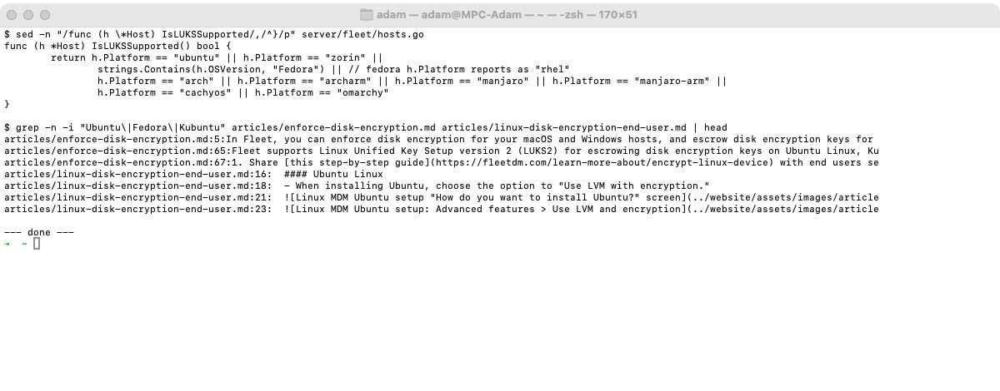

---

### F-Fedora-VM-repeat: Fedora VM: repeat Q1 and Q2

**Result: NOT RUN** · [full notes](test-evidence/desk/F-Fedora-VM-repeat/result.md)

---

## Ubuntu VM

### 00: environment

**Result: info** · [full notes](test-evidence/ubuntu/00-environment/result.md)

- **Objective:** Record exactly what was tested so a reader can recreate the lab.

**Output:** [01-versions.txt](test-evidence/ubuntu/00-environment/01-versions.txt)

**screenshot versions**

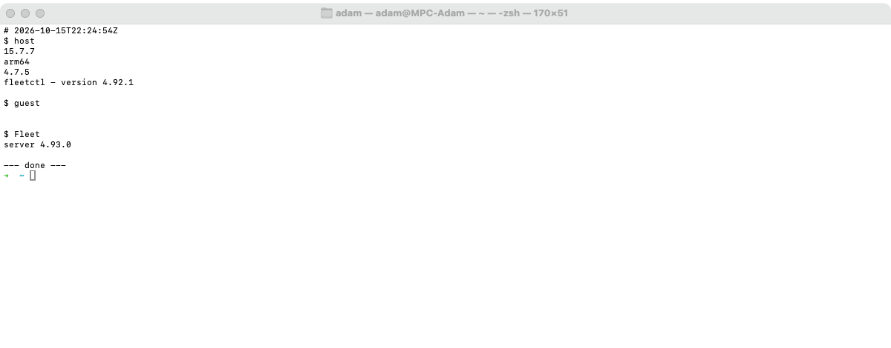

---

### G: the real Fleet Desktop banner and the real passphrase dialog

**Result: PASS** · [full notes](test-evidence/ubuntu/G-banner-and-dialog/result.md)

- **Objective:** Capture what an end user actually sees: the "Create key" banner on My device, and the passphrase dialog orbit opens.
- **Expected:** Banner when Fleet needs a key; a passphrase prompt dialog after Create key.

**Output:** [00-state-setup.txt](test-evidence/ubuntu/G-banner-and-dialog/00-state-setup.txt) · [01-fleet-status.txt](test-evidence/ubuntu/G-banner-and-dialog/01-fleet-status.txt)

**real passphrase dialog empty**

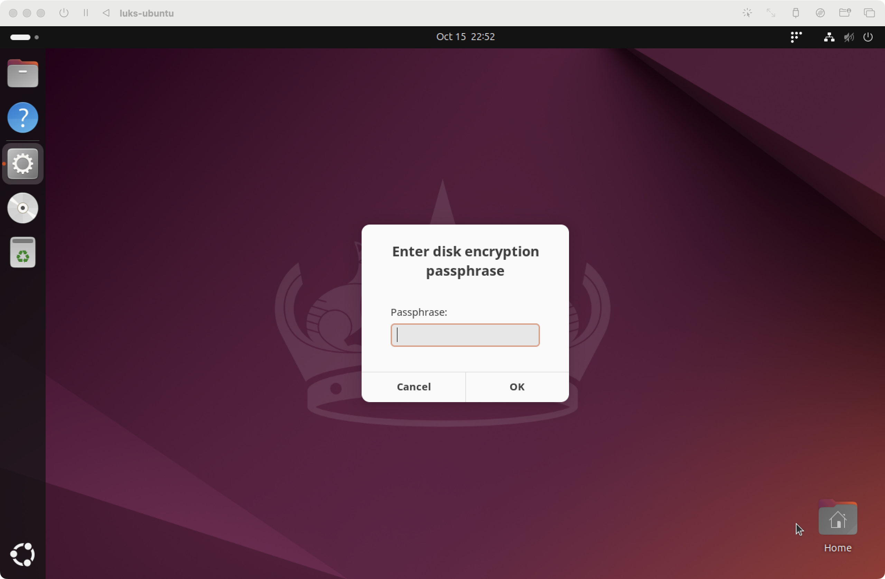

**real dialog after timeout message**

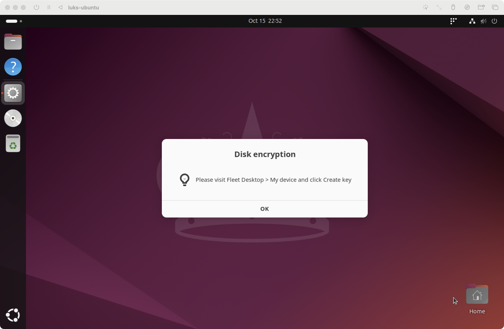

**my device page banner**

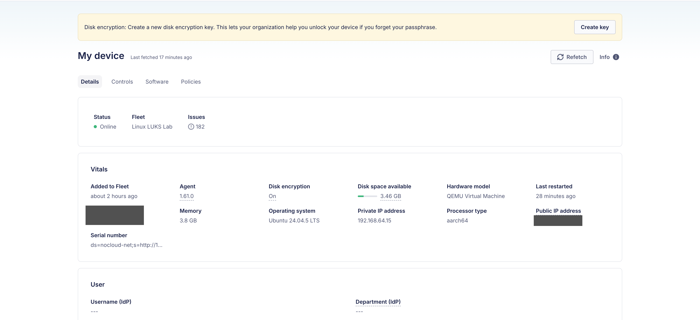

---

### K-1 and K-2: remove the end user's keyslot (no reboot)

**Result: PASS** · [full notes](test-evidence/ubuntu/K-1-remove-user-keyslot/result.md)

- **Objective:** Remove slot 0 with the escrowed key and see what changes in the header and for each key.
- **Expected:** One slot left (the escrow one). UUID and digest unchanged. The running system is unaffected.

**Output:** [01-kill-user-slot.txt](test-evidence/ubuntu/K-1-remove-user-keyslot/01-kill-user-slot.txt) · [02-luksdump-after.txt](test-evidence/ubuntu/K-1-remove-user-keyslot/02-luksdump-after.txt) · [03-who-can-unlock-now.txt](test-evidence/ubuntu/K-1-remove-user-keyslot/03-who-can-unlock-now.txt)

**screenshot who can unlock**

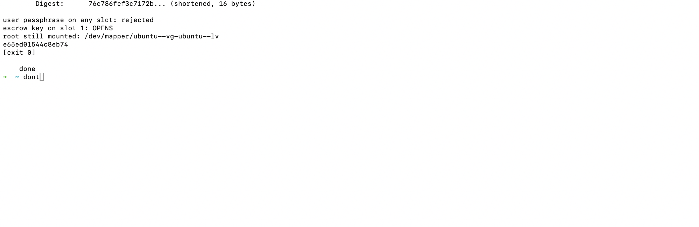

---

### K-11: a header backup brings a removed key back

**Result: PASS** · [full notes](test-evidence/ubuntu/K-11-header-restore-brings-back-removed-slot/result.md)

- **Objective:** How permanent is removing a keyslot?
- **Expected:** `luksHeaderRestore` from an earlier backup restores the removed slot.

**Output:** [01-restore.txt](test-evidence/ubuntu/K-11-header-restore-brings-back-removed-slot/01-restore.txt)

**screenshot restore**

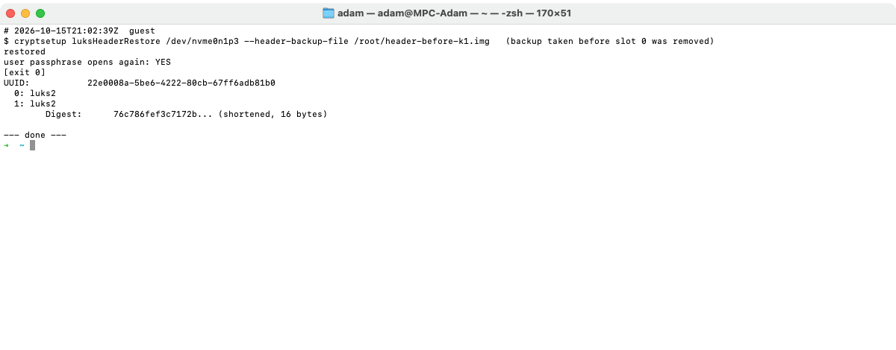

---

### K-12: recovering access after every known key was lost

**Result: PASS** · [full notes](test-evidence/ubuntu/K-12-recover-key-from-running-system/result.md)

- **Objective:** A test script deleted the only key file while the disk had one slot. Can access be recovered without any passphrase?
- **Expected:** Not from the running system's memory (root can't read the volume key); yes from an earlier header backup.

**Output:** [01-recovery.txt](test-evidence/ubuntu/K-12-recover-key-from-running-system/01-recovery.txt)

**screenshot recovery**

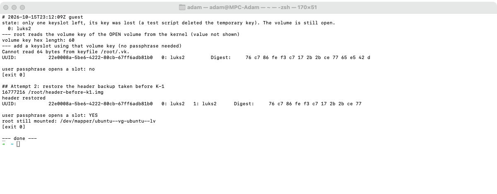

---

### K-1 / K-3: remove the end user's key, then reboot: the old passphrase is rejected

**Result: PASS** · [full notes](test-evidence/ubuntu/K-3-reboot-old-passphrase-rejected/result.md)

- **Objective:** Q1: after IT removes the end user's LUKS key, what happens at boot?
- **Expected:** The user's passphrase no longer unlocks the disk. Only the escrowed key does.

**Output:** [01-remove-user-slot-again.txt](test-evidence/ubuntu/K-3-reboot-old-passphrase-rejected/01-remove-user-slot-again.txt) · [03-guest-reachable.txt](test-evidence/ubuntu/K-3-reboot-old-passphrase-rejected/03-guest-reachable.txt)

**unlock prompt after old passphrase typed**

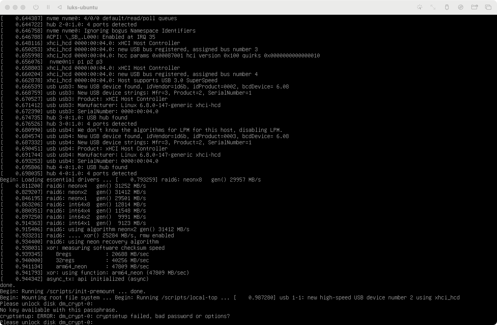

---

### K-4: reboot with only the escrowed key

**Result: PASS** · [full notes](test-evidence/ubuntu/K-4-reboot-with-escrow-key/result.md)

- **Objective:** Q1: with the user's slot removed, does the escrowed key boot the machine?
- **Expected:** Yes. IT can unlock it.

**Output:** [00-boot.txt](test-evidence/ubuntu/K-4-reboot-with-escrow-key/00-boot.txt) · [02-after-unlock.txt](test-evidence/ubuntu/K-4-reboot-with-escrow-key/02-after-unlock.txt)

**screenshot after unlock**

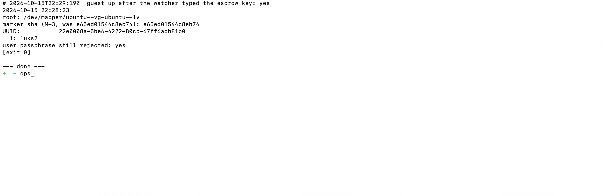

---

### K-5: does every reboot ask for the key again?

**Result: PASS** · [full notes](test-evidence/ubuntu/K-5-every-boot-asks-again/result.md)

- **Objective:** Q1 claim: 'removing the end user's LUKS key means they have to reach out to IT every time they reboot'.
- **Expected:** Yes: nothing remembers the key, so each boot stops at the unlock prompt.

**Output:** [00-boot.txt](test-evidence/ubuntu/K-5-every-boot-asks-again/00-boot.txt) · [02-after-unlock.txt](test-evidence/ubuntu/K-5-every-boot-asks-again/02-after-unlock.txt)

**screenshot second reboot**

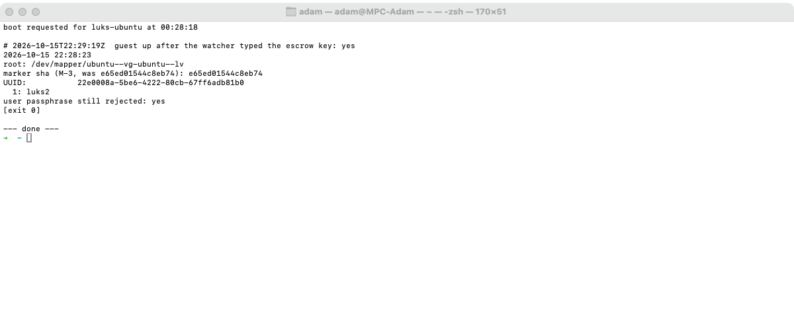

---

### K-6: is there any other unlock path?

**Result: PASS** · [full notes](test-evidence/ubuntu/K-6-no-other-unlock-path/result.md)

- **Objective:** Q1 customer idea: remove the user's key so they need IT. Check nothing else unlocks the disk (TPM token, keyfile, crypttab keyscript).
- **Expected:** None on a standard install.

**Output:** [01-unlock-paths.txt](test-evidence/ubuntu/K-6-no-other-unlock-path/01-unlock-paths.txt)

**screenshot unlock paths**

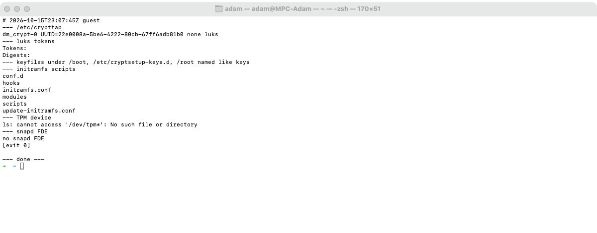

---

### K-7: what Fleet shows after the user slot is removed

**Result: PASS** · [full notes](test-evidence/ubuntu/K-7-fleet-after-user-slot-removed/result.md)

- **Objective:** Does Fleet notice that the end user's key is gone?
- **Expected:** No: Fleet verifies the escrow slot's salt, not the user's slot.

**Output:** [01-fleet-status.txt](test-evidence/ubuntu/K-7-fleet-after-user-slot-removed/01-fleet-status.txt)

**screenshot fleet still verified**

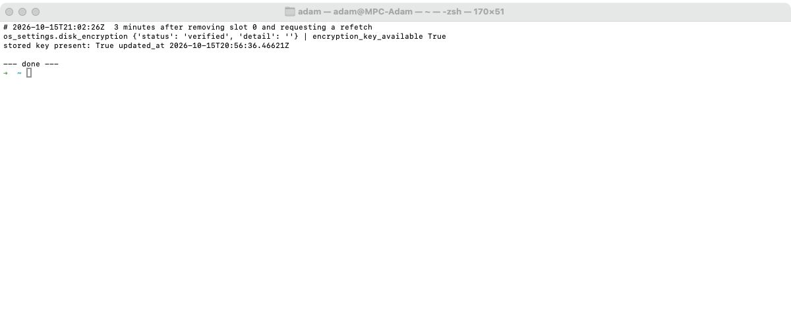

---

### K-9: negative control, remove the ESCROW slot instead

**Result: PASS** · [full notes](test-evidence/ubuntu/K-9-escrow-slot-removed-fleet-reaction/result.md)

- **Objective:** Does Fleet notice when its own key slot is removed? (Customer report: fleetdm/fleet#52236, closed as fixed.)
- **Expected:** Fleet detects it, shows action required, and offers re-escrow.

**Output:** [01-remove-escrow-slot.txt](test-evidence/ubuntu/K-9-escrow-slot-removed-fleet-reaction/01-remove-escrow-slot.txt) · [02-fleet-status-polling.txt](test-evidence/ubuntu/K-9-escrow-slot-removed-fleet-reaction/02-fleet-status-polling.txt) · [03-re-escrow.txt](test-evidence/ubuntu/K-9-escrow-slot-removed-fleet-reaction/03-re-escrow.txt)

**screenshot fleet polling**

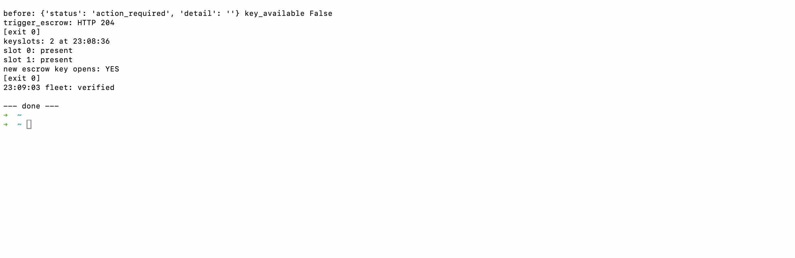

---

### M-1 to M-3: key slot changes don't change the volume key or the data

**Result: PASS** · [full notes](test-evidence/ubuntu/M-2-keyslot-changes-keep-master-key/result.md)

- **Objective:** Q2: does adding, changing or removing a keyslot invalidate or change any encryption key?
- **Expected:** Slots change. UUID and master key digest are identical every time. The data is untouched.

**Output:** [01-q2-run.txt](test-evidence/ubuntu/M-2-keyslot-changes-keep-master-key/01-q2-run.txt)

**screenshot run**

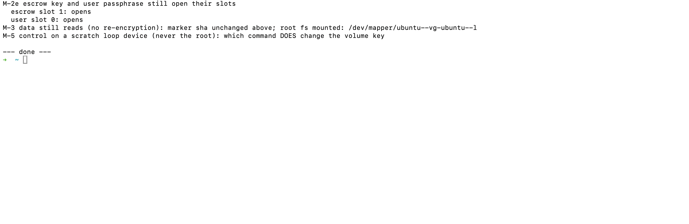

---

### M-5: control, what DOES change the volume key

**Result: PASS** · [full notes](test-evidence/ubuntu/M-5-control-reencrypt-changes-the-key/result.md)

- **Objective:** Show the test can detect a key change, so "unchanged" above means something.
- **Expected:** `luksAddKey` and `luksKillSlot` keep the digest. `reencrypt` and `luksFormat` change it.

**Output:** [01-control.txt](test-evidence/ubuntu/M-5-control-reencrypt-changes-the-key/01-control.txt)

**screenshot control**

---

### S-1: Ubuntu 24.04.5 desktop installer, "Use LVM and encryption"

**Result: PASS** · [full notes](test-evidence/ubuntu/S-1-installer/result.md)

- **Objective:** Install Ubuntu the way the end user guide says (step 1), in a UTM VM, with a window screenshot of each page.
- **Expected:** An encrypted LVM install with a passphrase chosen at the installer.

**grub try or install**

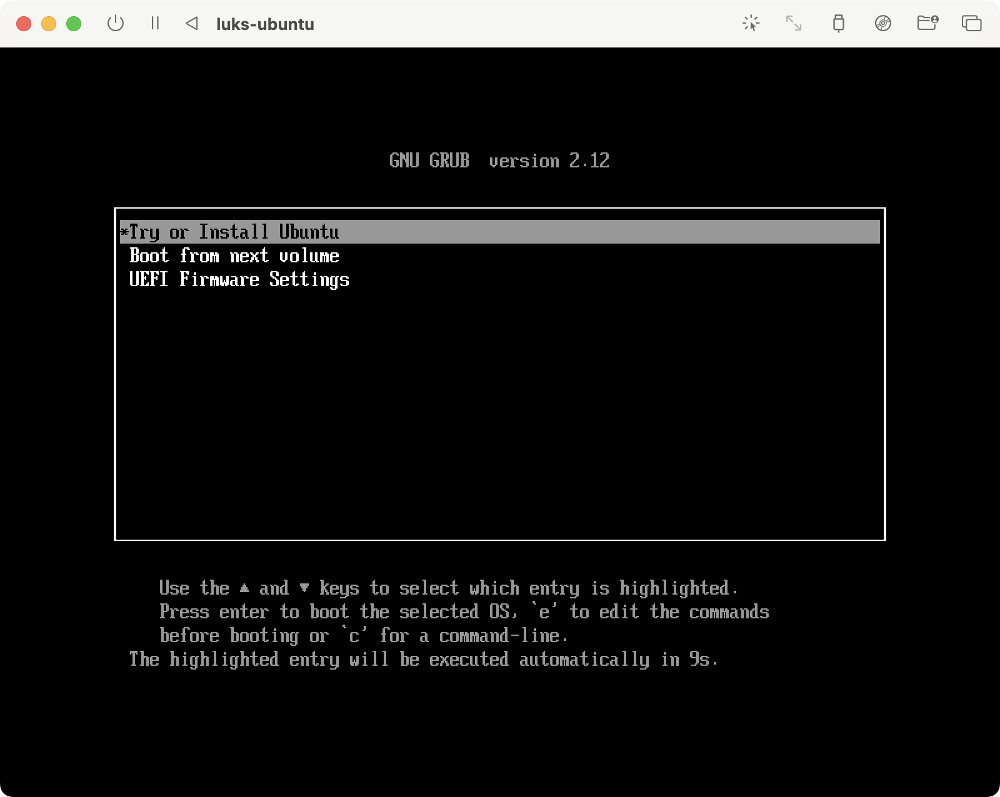

**disk setup how do you want to install**

**advanced features dialog**

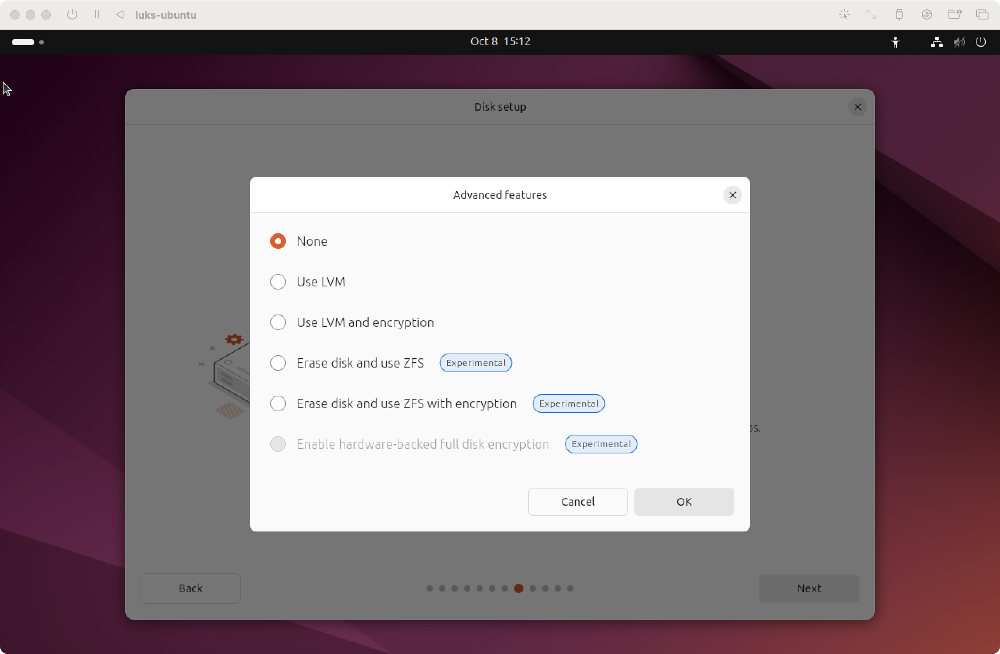

**use lvm and encryption selected**

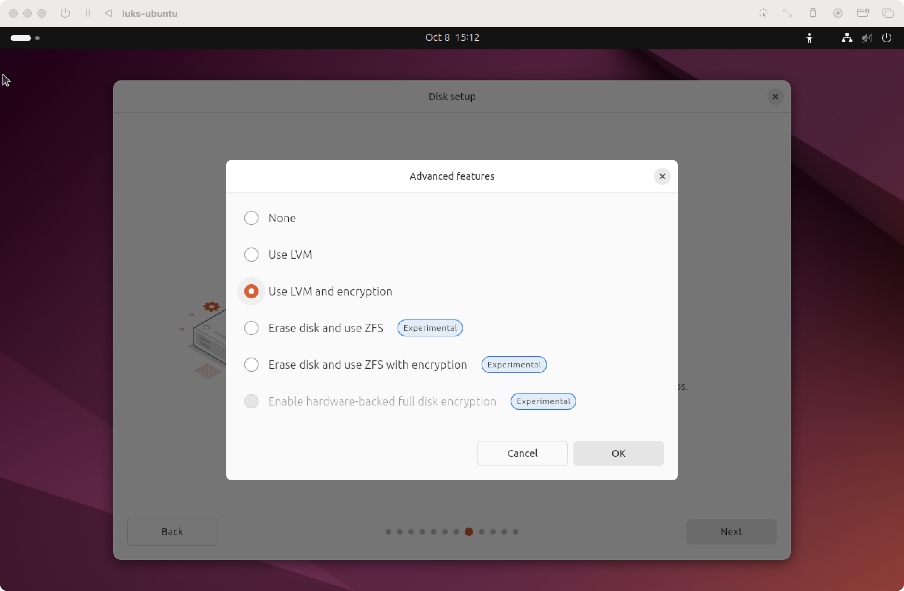

**lvm and encryption confirmed**

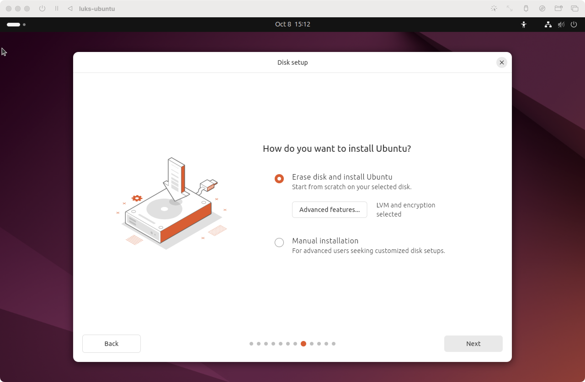

**create passphrase page**

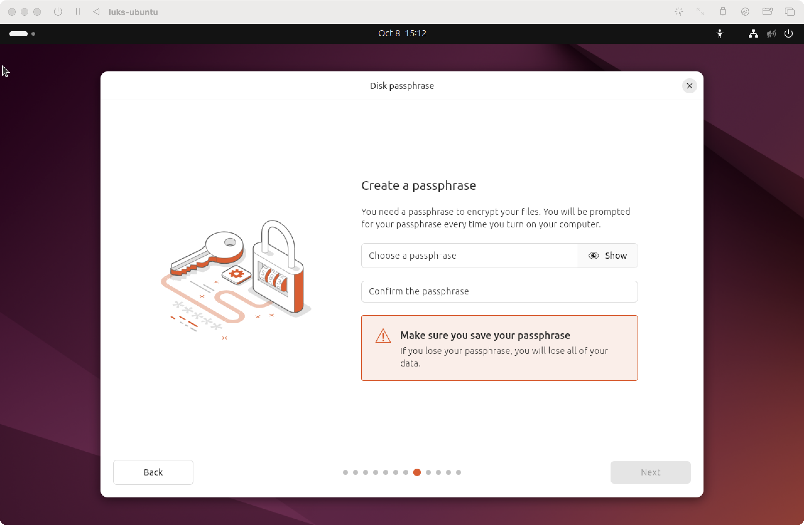

**ready to install review luks lvm**

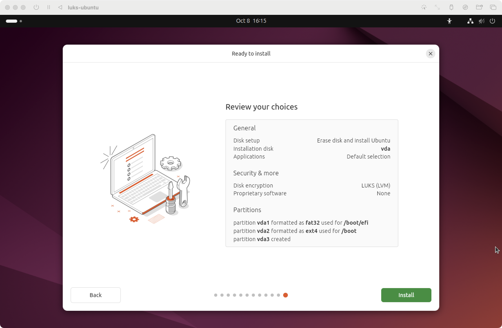

**installation complete**

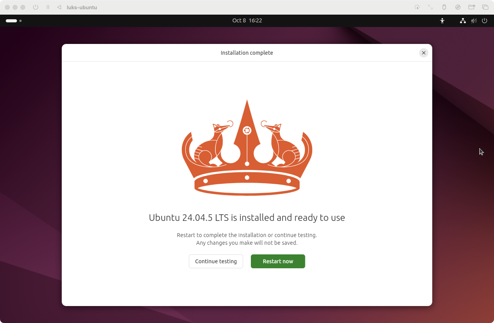

**remove installation medium**

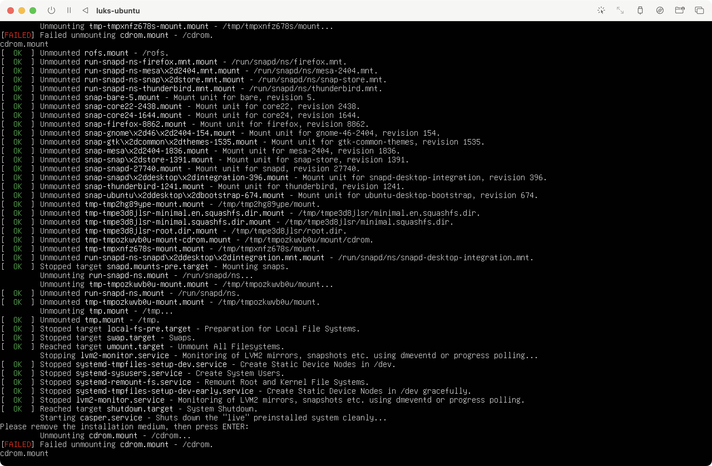

---

### S-10: final state of the lab VM after all tests

**Result: PASS** · [full notes](test-evidence/ubuntu/S-10-final-state-after-cleanup/result.md)

- **Objective:** Leave the VM in a known, healthy state and show Fleet agrees.
- **Expected:** User passphrase on one slot, Fleet's escrow key on another, nothing else, Fleet Verified.

**Output:** [01-slots.txt](test-evidence/ubuntu/S-10-final-state-after-cleanup/01-slots.txt)

**screenshot final slots**

---

### S-1c: second Ubuntu desktop install attempt (VM `luks-ubuntu2`, since deleted)

**Result: FAIL** · [full notes](test-evidence/ubuntu/S-1c-install-virtio-gpu/result.md)

- **Objective:** Get the desktop installer working on a new VM and follow the end user guide.
- **Expected:** An encrypted LVM install.

**create passphrase page**

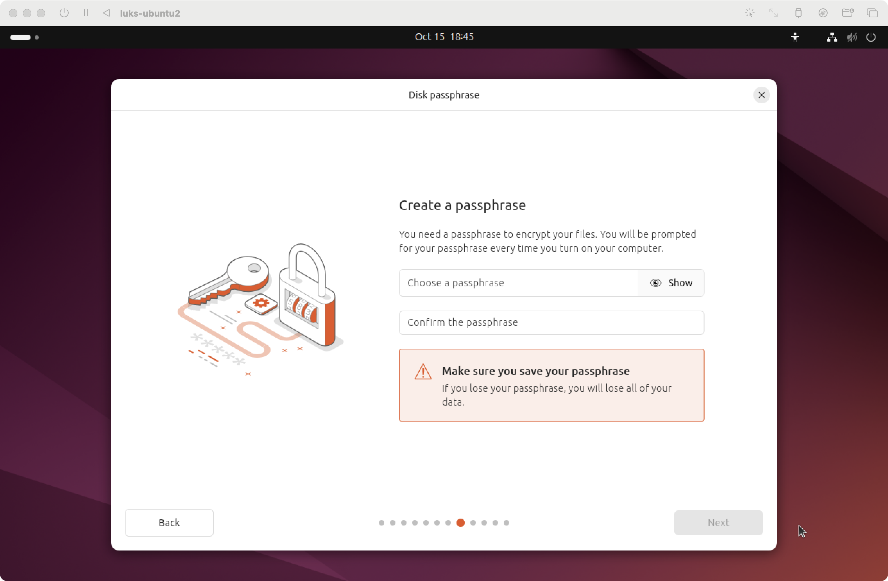

**choose automated installation**

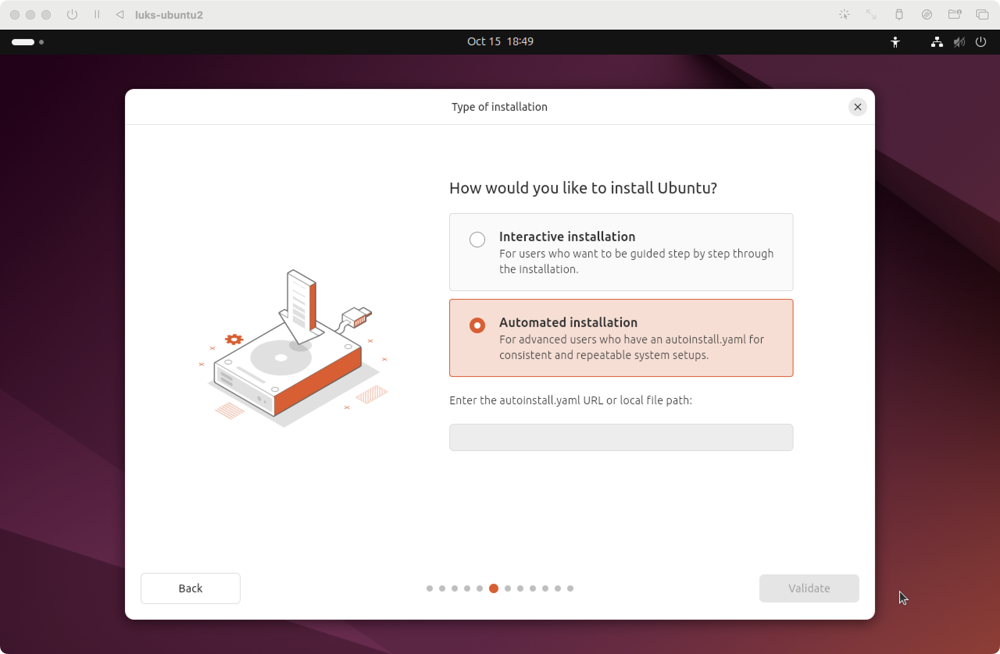

**validate**

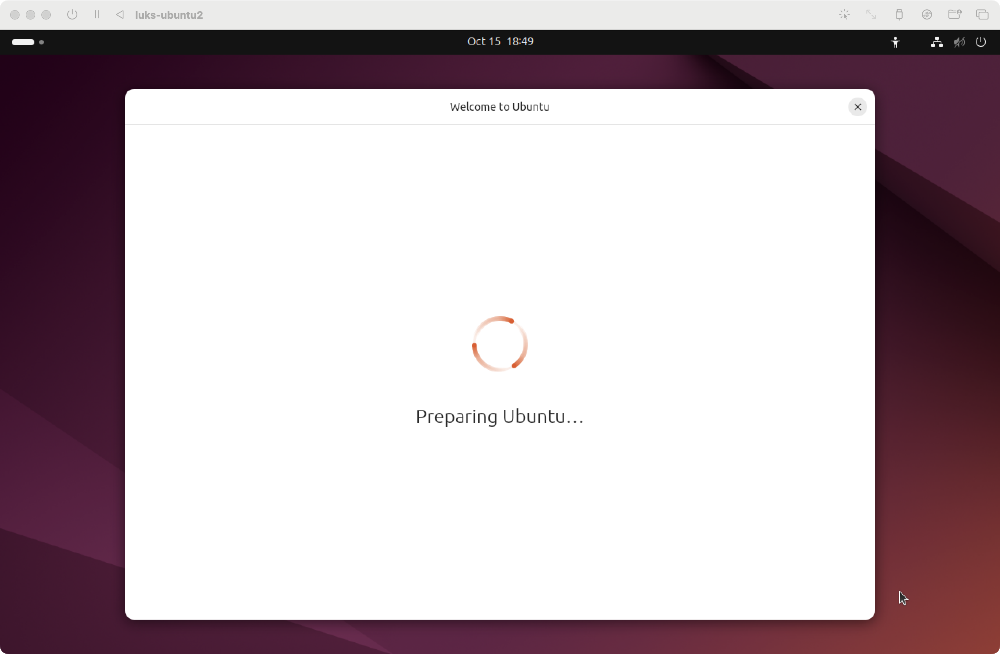

**installing copying files**

---

### S-1d: Ubuntu 24.04.5 server ISO, unattended autoinstall (LVM on LUKS), VM `luks-ubuntu`

**Result: PASS** · [full notes](test-evidence/ubuntu/S-1d-server-autoinstall/result.md)

- **Objective:** A working encrypted Ubuntu VM with no one at the keyboard.
- **Expected:** Installs unattended, powers off, boots from the encrypted disk.

**first boot after unlock**

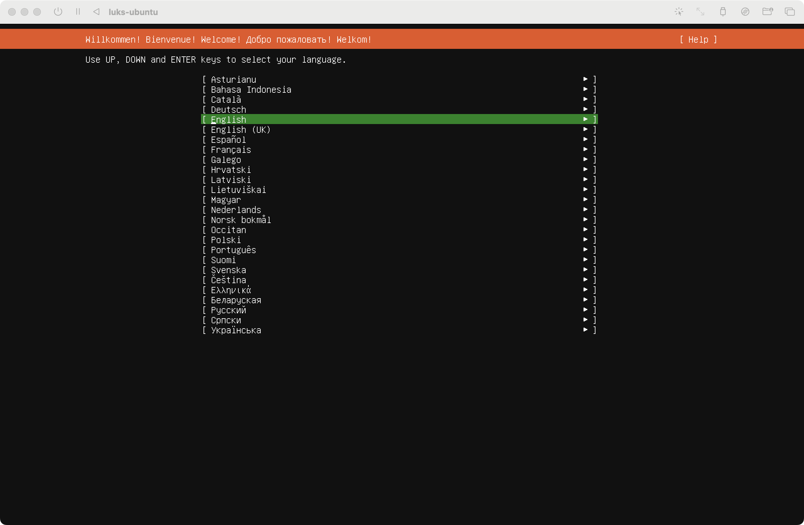

---

### S-3: baseline luksDump (before Fleet escrow)

**Result: PASS** · [full notes](test-evidence/ubuntu/S-3-baseline-luksdump/result.md)

- **Objective:** Record the LUKS header before any Fleet change.
- **Expected:** LUKS2, one keyslot (the end user's), no tokens.

**Output:** [01-luksdump-baseline.txt](test-evidence/ubuntu/S-3-baseline-luksdump/01-luksdump-baseline.txt) · [02-lsblk-guide-step2.txt](test-evidence/ubuntu/S-3-baseline-luksdump/02-lsblk-guide-step2.txt)

**screenshot baseline**

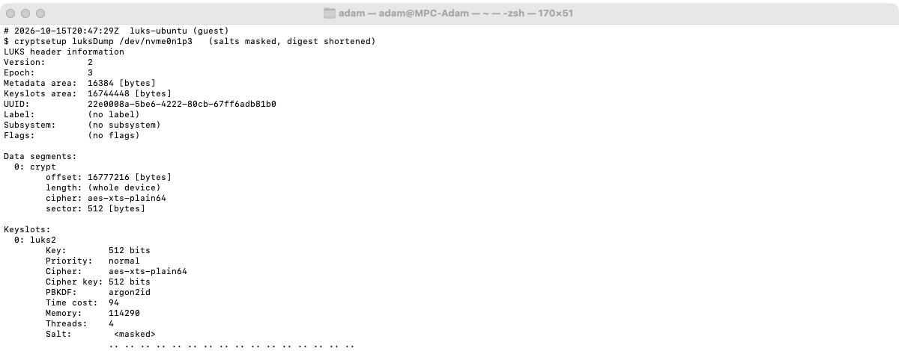

---

### S-4: trigger Fleet's Linux escrow (the "Create key" action)

**Result: PASS** · [full notes](test-evidence/ubuntu/S-4-escrow-trigger/result.md)

- **Objective:** Run the end user escrow flow without a person at the keyboard.
- **Expected:** Orbit asks for the passphrase, adds a keyslot, escrows the new key.

**Output:** [01-trigger.txt](test-evidence/ubuntu/S-4-escrow-trigger/01-trigger.txt) · [02-keyslot-count-polling.txt](test-evidence/ubuntu/S-4-escrow-trigger/02-keyslot-count-polling.txt) · [03-orbit-log-dialogs.txt](test-evidence/ubuntu/S-4-escrow-trigger/03-orbit-log-dialogs.txt)

**screenshot trigger and slots**

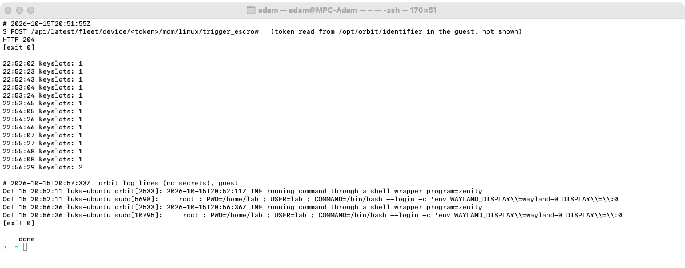

---

### S-5: Fleet's view after the escrow

**Result: PASS** · [full notes](test-evidence/ubuntu/S-5-fleet-status-after-escrow/result.md)

- **Objective:** Does Fleet show the host as Verified and hold the key?
- **Expected:** Verified, key available, key stored.

**Output:** [01-fleet-api-after-escrow.txt](test-evidence/ubuntu/S-5-fleet-status-after-escrow/01-fleet-api-after-escrow.txt)

**screenshot fleet api**

---

### S-6: luksDump after the escrow

**Result: PASS** · [full notes](test-evidence/ubuntu/S-6-luksdump-after-escrow/result.md)

- **Objective:** What does Fleet's escrow change in the LUKS header?
- **Expected:** One new keyslot. UUID and master key digest unchanged.

**Output:** [01-luksdump-after-escrow.txt](test-evidence/ubuntu/S-6-luksdump-after-escrow/01-luksdump-after-escrow.txt)

**screenshot baseline vs after**

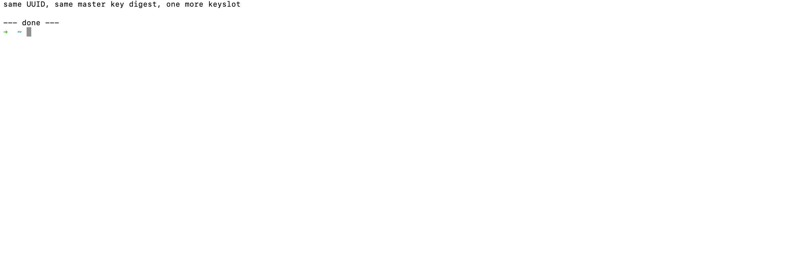

---

### S-7: the escrowed key opens only its own slot

**Result: PASS** · [full notes](test-evidence/ubuntu/S-7-escrowed-key-unlocks-slot1/result.md)

- **Objective:** Confirm the key Fleet stores is a separate slot from the end user's.
- **Expected:** Escrow key opens slot 1, not slot 0. User passphrase opens slot 0, not slot 1.

**Output:** [01-which-slot-opens-with-which-key.txt](test-evidence/ubuntu/S-7-escrowed-key-unlocks-slot1/01-which-slot-opens-with-which-key.txt)

**screenshot which key opens what**

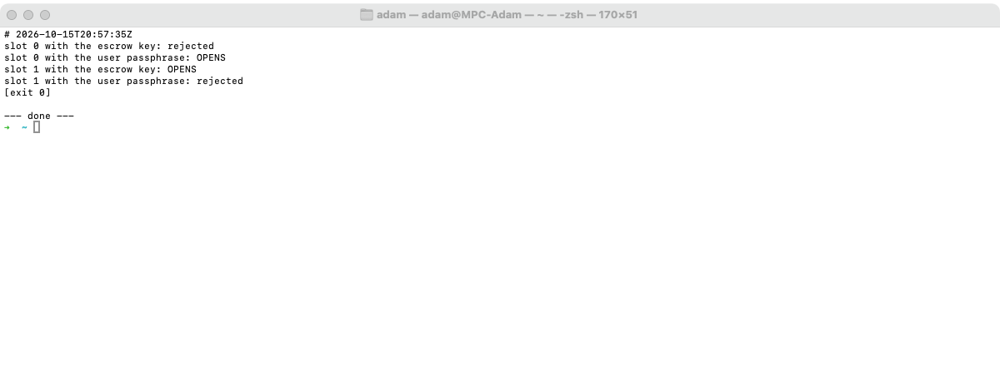

---

### S-8: first boot after install

**Result: BLOCKED** · [full notes](test-evidence/ubuntu/S-8-first-boot/result.md)

- **Objective:** Boot the installed encrypted Ubuntu, reach the disk unlock prompt, and the desktop.
- **Expected:** An unlock prompt, then the login or desktop.

**ramfb boot**

---

### S-9: Fleet after the reboots

**Result: PASS** · [full notes](test-evidence/ubuntu/S-9-fleet-after-reboots/result.md)

- **Objective:** Fleet still reports the host and key sensibly after a user slot removal and two reboots.
- **Expected:** verified, key available.

**Output:** [01-fleet.txt](test-evidence/ubuntu/S-9-fleet-after-reboots/01-fleet.txt)

**screenshot fleet**

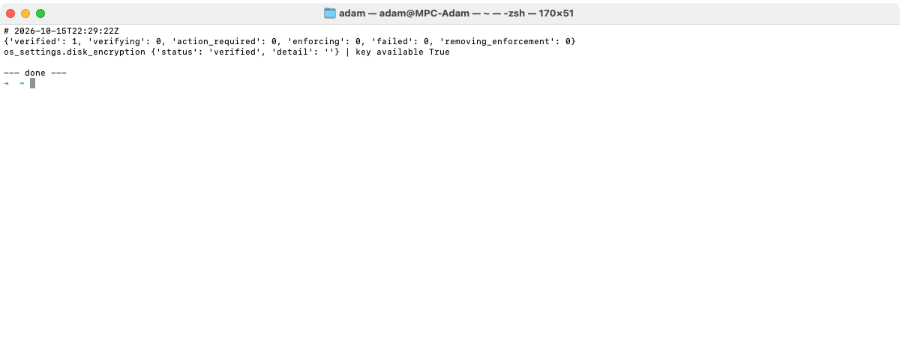

---
